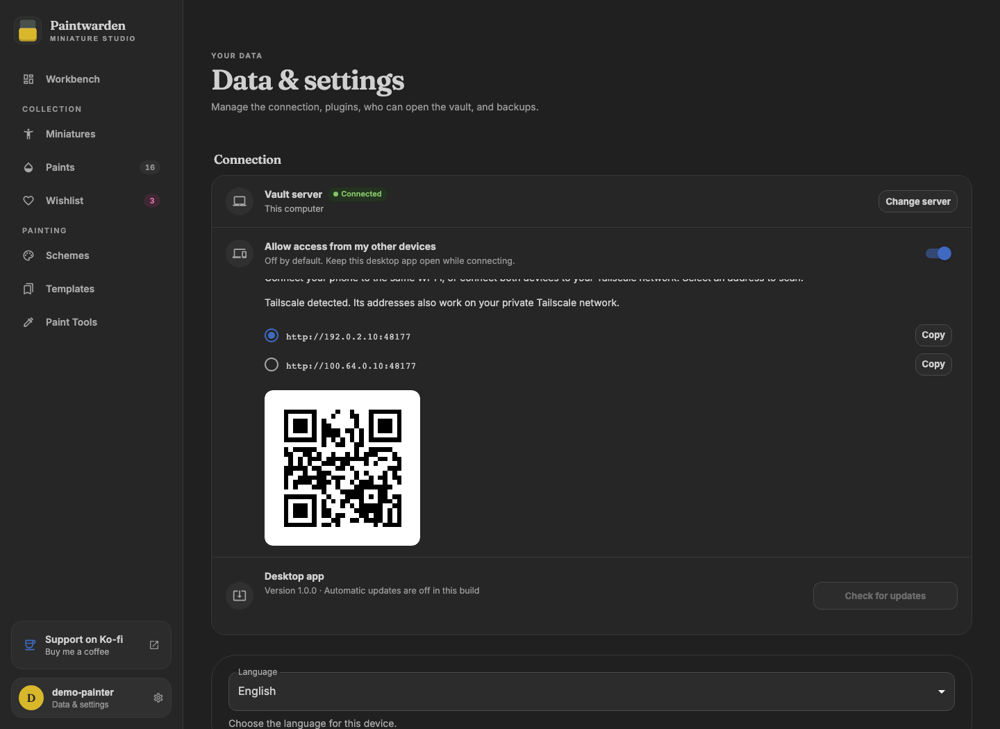

# Open your desktop vault on your phone

Paintwarden's desktop app can share its **local vault** with your other devices. This is off by default. Your computer must stay awake with Paintwarden running; your phone uses the same vault, not a second copy.

1. Finish account setup in the desktop app. Remember that account's username and password.
2. Open **Settings → Allow access from my other devices** and turn it on. This setting is available only when the desktop app uses **this computer**, not a remote server.
3. If macOS asks whether to allow incoming connections, choose **Allow** for Paintwarden's bundled server. This normally happens on the first enable; macOS controls the prompt and may ask again after updates or firewall changes. If blocked, review **System Settings → Network → Firewall → Options**. Do not turn off the firewall.
4. Put your phone on the same Wi-Fi, or connect both devices to your Tailscale network. Select a reachable address in Settings, then scan its QR code with your phone's camera. You can also copy the address and open it manually. The QR is generated on your computer and contains only the address, never your password or session.
5. Sign in on your phone with the **same Paintwarden account**. Phone access always requires sign-in, even if you have disabled sign-in for the desktop vault. Your miniatures, images, uploads, live changes and Swatch Scan use the existing responsive web interface.
6. Turn the setting off to stop network access immediately, including live connections. The desktop app keeps working. The selected network port is saved separately from your vault; if it is already taken, Paintwarden chooses and saves another port. Use the new address/QR if the port changes.



*Illustration with sample addresses and a sample QR; your addresses will differ.*

**Network warning:** anyone who can reach your computer on the network can reach the login page. Plain HTTP does not encrypt your password or vault traffic. Use only a trusted network, or use Tailscale (which encrypts traffic between your devices). Guest Wi-Fi or client isolation may prevent devices from reaching each other. A VPN, sleeping computer or changed Wi-Fi address can also make an old QR stop working; reopen Settings to refresh the addresses. Do not forward this port from your router to the public Internet.

## Optional HTTPS with Tailscale Serve

Plain-HTTP LAN pages may have limited **Add to Home Screen**, camera and other browser features. Tailscale's direct `100.x` address is still an HTTP browser origin, even though Tailscale encrypts its network traffic.

For a browser HTTPS origin, first install/sign in to Tailscale on both devices and enable MagicDNS/HTTPS for your tailnet. With Paintwarden's phone access enabled, copy the **Tailscale Serve** command shown in Settings. It looks like this (replace the port with the one Settings shows):

```sh
tailscale serve http://127.0.0.1:48177
```

Run it yourself in Terminal, review any Tailscale confirmation, then open the **HTTPS MagicDNS URL printed by Tailscale** on your phone. Sign in normally. Paintwarden never runs Serve or changes your Tailscale configuration automatically. Only your detected MagicDNS name is accepted for this local HTTPS proxy. If it was not detected, make sure Tailscale is connected and reopen Settings before trying Serve. Tailscale Serve must run on the same computer as Paintwarden; another reverse proxy is not supported by this desktop feature.

When finished, turn phone access off in Paintwarden; this stops access through Serve too. You can also remove the Tailscale Serve configuration yourself with `tailscale serve reset` (this resets other Serve routes on that computer too, so review your configuration first).

This feature does not change HTTPS cookies or proxy settings for Docker/server deployments.

## Optional always-on alternative: Docker or your own server

If you prefer phone access without keeping your desktop computer awake, run Paintwarden with Docker Compose on a server or NAS that stays on. This is an alternative to sharing the desktop app's local vault, not a requirement for the Settings-and-QR setup above.

Open that server's reachable address in your phone's browser on the same trusted Wi-Fi or Tailscale network, and sign in with the owner account for that vault. Use the host and port configured for your deployment, not the desktop app's QR address. For example, `http://192.0.2.10:3000` is a documentation-only sample; replace it with your server's actual address. For remote access, prefer Tailscale rather than forwarding a router port to the public Internet. Plain HTTP does not encrypt passwords or vault traffic; use a trusted network or Tailscale, and configure HTTPS if needed for browser features.

The desktop app can connect to the same server in remote mode, but it does not keep an offline copy. A separately created server vault is not automatically a copy of your desktop vault; use Export and Restore if you want to move your collection, and set up the server's owner account separately. See the repository's Docker/server setup instructions for deployment, persistent storage and backups. The desktop phone-access toggle does not manage a separate Docker/server deployment.
